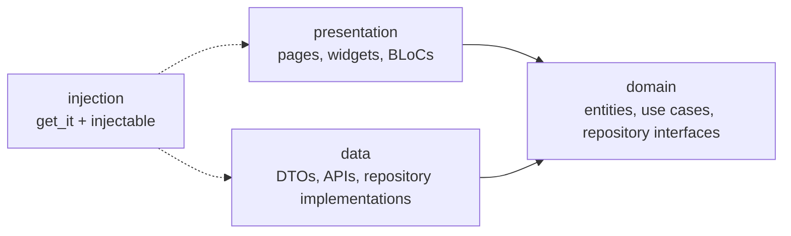

# DummyJSON Shop

A Flutter app for iOS and Android built on the public [DummyJSON](https://dummyjson.com) API:
log in, browse the product catalog, open a product.

## Run it

Built with **Flutter 3.44.8 (Dart 3.12)**.

```sh
flutter pub get
flutter run
```

Log in with **`emilys` / `emilyspass`**.

- Generated code (`*.g.dart`, `*.freezed.dart`, DI config, localizations) is committed, so the app runs
  without code generation. After changing an annotated class:
  `dart run build_runner build --delete-conflicting-outputs`.
- The API base URL can be overridden: `flutter run --dart-define=BASE_URL=https://dummyjson.com`.
- `flutter test` runs 171 tests (about 97% line coverage of the hand-written code). CI runs the same
  checks on every push to `main` and every pull request: [`.github/workflows/ci.yml`](.github/workflows/ci.yml).

## What it does

- **Login** with `POST /auth/login`. The access and refresh tokens are stored in the iOS Keychain or
  Android Keystore-backed storage. The session is restored on the next launch, and the user can log out.
- **Expired sessions.** On a `401`, the app refreshes the access token with `POST /auth/refresh` and
  retries the request without the user noticing. If the refresh token itself is rejected, the user goes
  back to the login screen.
- **Product list** with `GET /products`: loading, error (with retry) and empty states,
  pull-to-refresh, and infinite scrolling 20 products at a time. If loading more fails, the list
  shows the error with a retry button.
- **Product detail.** Tapping a product opens it at once with the data the list already has (the
  thumbnail flies into the gallery), then `GET /products/{id}` refreshes it. Opened directly at
  `/products/:id`, without the list's data, the page loads by id.

## Architecture

Clean Architecture in three layers. Dependencies point inwards, to the domain:



```
lib/
  domain/        entities, repository interfaces, use cases, Result and Failure (pure Dart)
  data/          DTOs with toDomain(), Retrofit APIs, token storage, Dio interceptors, repositories
  presentation/  app shell and router, then one folder per feature with bloc/, pages/, widgets/
  injection/     get_it + injectable setup, modules for Dio and secure storage
  res/           colors, spacing, typography, theme
  l10n/          ARB strings and the generated localizations
```

- **Domain** has no Flutter, Dio or JSON. Repositories return `Result<T>`: either `Ok(value)` or
  `Err(failure)`, where `Failure` is a sealed type (network, invalid credentials, unauthorized,
  not found, server, unknown).
- **Data** maps every transport error to a `Failure` in one place (`safeCall`), so nothing above it
  sees a `DioException`. DTOs map themselves to entities with `toDomain()`. Tokens never leave this
  layer.
- **Presentation** talks to the domain only: BLoCs call use cases, never repositories. The login,
  list and detail screens each get their own BLoC from the router. `SessionBloc` is the one app-wide
  BLoC.
- **Injection** is the composition root. `getIt` is used only in `main.dart` and in route builders;
  every other class receives its dependencies through its constructor.

For example, a login goes `LoginBloc` → `LoginUseCase` → `AuthRepository` (the interface) →
`AuthRepositoryImpl` → `AuthApi`. The repository stores the tokens and reports "authenticated", the
`SessionBloc` picks that up, and the router's guard opens the product list. The login screen never
navigates itself.

## Decisions

| Decision | Why |
|----------|-----|
| **BLoC**, with freezed sealed events and states | Logic stays out of widgets and is easy to test with `bloc_test`. A sealed state makes each screen's `switch` exhaustive: a new state cannot be forgotten in the UI. |
| **`Result<T>`** instead of thrown exceptions | Failures are part of the type, so every caller handles them. The UI turns each `Failure` into a message. |
| **One route guard** follows the session | Login, logout and an expired session all navigate through one function (`authRedirect`), driven by the session status stream. |
| **Routes build their own `MaterialPage`** | go_router 18 recognizes only the `MaterialApp` from the new `material_ui` package, not the one in `package:flutter/material.dart`. Left to itself, it builds pages with no transition, so iOS loses the slide and the swipe-back gesture. |
| **Token refresh** in a `QueuedInterceptor` | Requests that fail together share one refresh. Refresh and retry go through a second Dio client without the auth interceptors, so there are no refresh loops or deadlocks. A rejected refresh token (4xx) ends the session; being offline does not. |
| **Pagination in the BLoC** | One page request at a time. A page that arrives after a pull-to-refresh is dropped instead of being mixed into the new list. A first page that doesn't fill the screen loads the next one, and after an error only the retry button loads again, so the app never fires request after request while offline. |
| **Detail shows the list's data first** | No spinner when opening a product, and the image can fly in. The BLoC starts with the list's product, because Flutter picks the Heroes to fly from the page's first frame. It still fetches by id, which keeps data fresh and makes `/products/:id` work on its own. |
| **Generated code committed** | Reviewers can run the app straight away. CI fails if the committed files no longer match their sources. |
| **Strict analysis** | Strict type checks, forgotten `await`s and unclosed streams as errors, and package imports only, so an import of `data/` inside `presentation/` stands out. |
| **Localization from the start** | All UI text lives in `lib/l10n/app_en.arb`; adding a language is a new ARB file. |

## Packages

`flutter_bloc` and `bloc_concurrency` (state), `freezed` and `json_serializable` (models), `get_it` and
`injectable` (DI), `go_router` (navigation and the auth guard), `dio` and `retrofit` (HTTP),
`flutter_secure_storage` (tokens), `cached_network_image` (images), `intl` (localization and prices).
Tests use `bloc_test` and `mocktail`.
